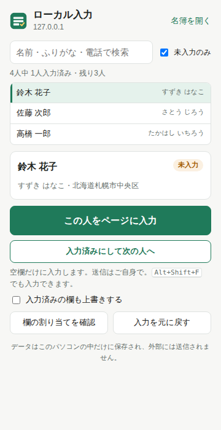
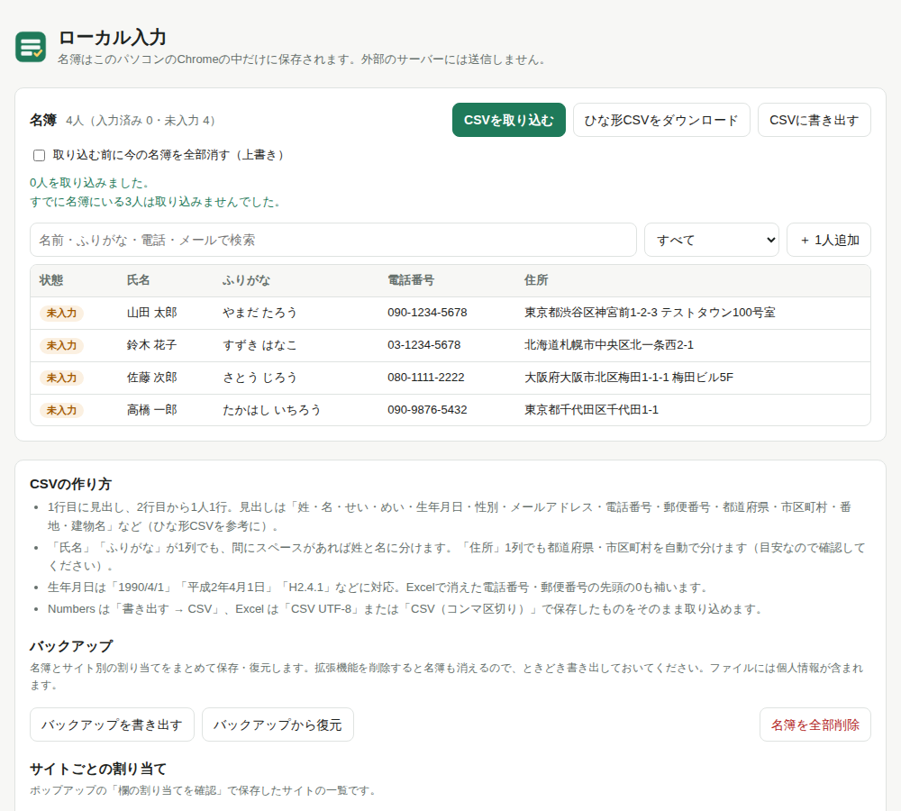

# ローカル入力（local-autofill）

登録フォームや問い合わせフォームに、自分の情報（名前・ふりがな・生年月日・住所・電話・メールなど）を**ワンクリックで入力する Chrome 拡張**です。

- **データはパソコンの中だけ**に保存します（拡張機能内の IndexedDB）。外部のサーバーやAIには一切送信しません。
- 拡張のページには `connect-src 'none'` を設定しており、仕組みとしても通信できません。
- 必要な権限は `activeTab` と `scripting` だけ。ボタンを押した（またはショートカットを使った）そのタブにだけ作用します。
- 送信ボタンは押しません。入力後の確認と送信はご自身で。

| ポップアップ | プロフィール登録 |
|---|---|
|  |  |

## できること

- 日本語フォーム向けの欄の判定
  - `autocomplete` 属性 → ラベル・直前の文字・表の見出し（th/dt）・placeholder の順に判定
  - 姓／名に分かれた欄、`〒[ ]-[ ]` のような郵便番号の分割、電話番号の3分割（`maxlength` を考慮）
  - 生年月日の「年・月・日」セレクトや和暦付きの選択肢（`1989年 昭和64年／平成元年` など）
  - ふりがなの **ひらがな／カタカナ** を欄に合わせて自動変換、「全角」指定の欄は全角に変換
  - 住所が「都道府県・市区町村・番地・建物名」に分かれていても、1つの欄にまとめられていても対応
  - 件名・物件名・お問い合わせ内容などの関係ない欄には入力しない
- React / Vue などで作られたフォームにも反映（入力イベントを発火）
- 空欄だけに入力（上書きも選べる）、**元に戻す**
- 判定が違う欄は、ポップアップの「欄の割り当てを確認」から選び直して**サイトごとに保存**
- 複数のプロフィール（個人用・仕事用など）、JSON での書き出し・読み込み
- ショートカット `Option + Shift + F`（Windows は `Alt + Shift + F`）

## 配布・インストール

友達向けの手順は [docs/INSTALL_mac.md](docs/INSTALL_mac.md) を参照してください。

配布用 zip の作り方:

```sh
npm run zip   # dist/local-autofill-<version>.zip ができる
```

## 開発

```sh
npm install
npm test      # Playwright で判定ロジック（3種類のフォーム）と拡張機能の通し動作をテスト
npm run icons # アイコンPNGを再生成
```

構成:

```
extension/
  manifest.json
  background.js        ショートカット時の入力
  content/filler.js    ページに注入する判定・入力ロジック（通信なし）
  lib/db.js            IndexedDB（プロフィール・サイト別割り当て・設定）
  lib/fill-tab.js      タブへの注入と呼び出し
  popup/               ポップアップ
  options/             プロフィール登録画面
test/pages/            テスト用フォーム（動画の例に近いもの・表形式・React）
```

## 制限

- 別ドメインの iframe 内に埋め込まれたフォームには入力できません。
- 画像認証（CAPTCHA）や確認画面の操作は行いません。
